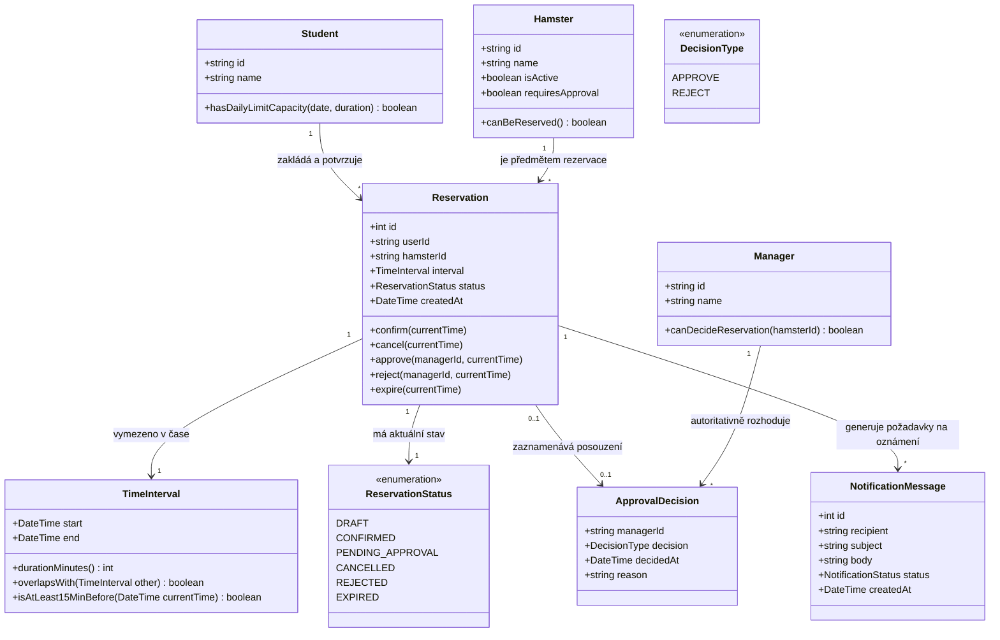
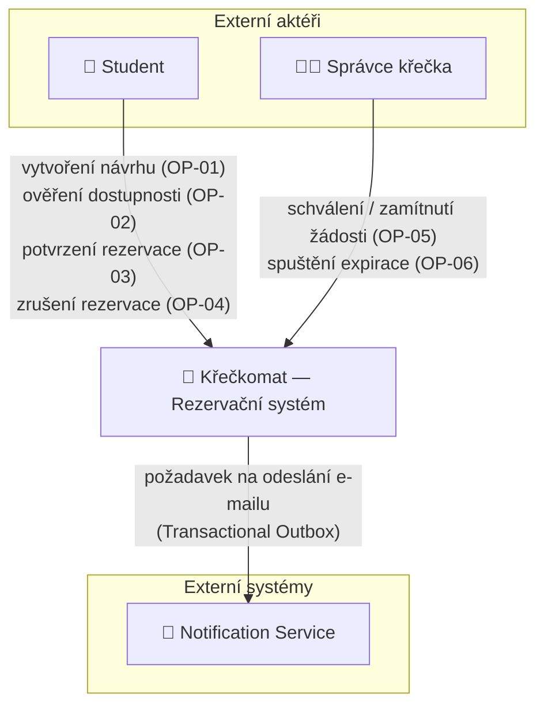
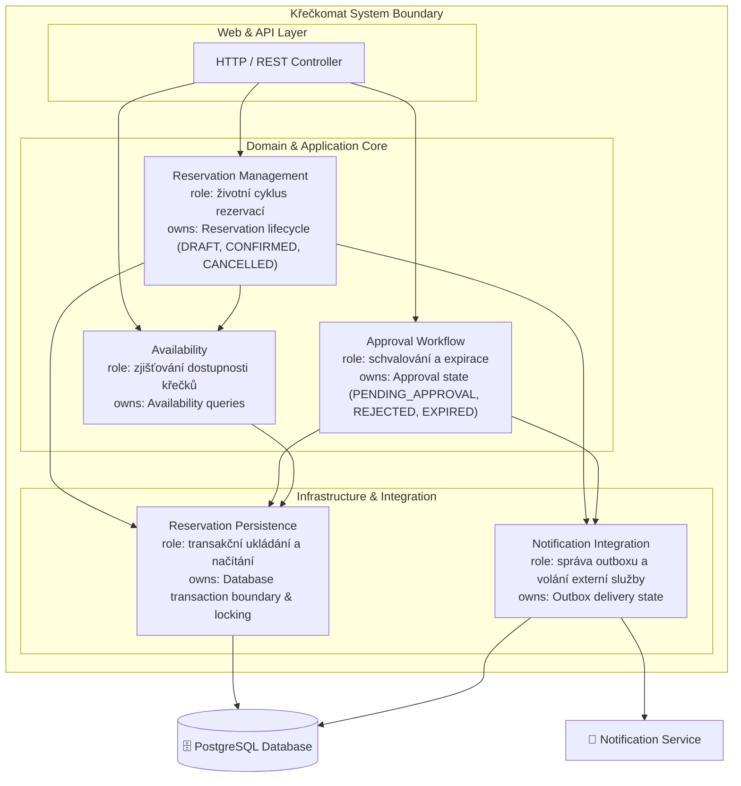
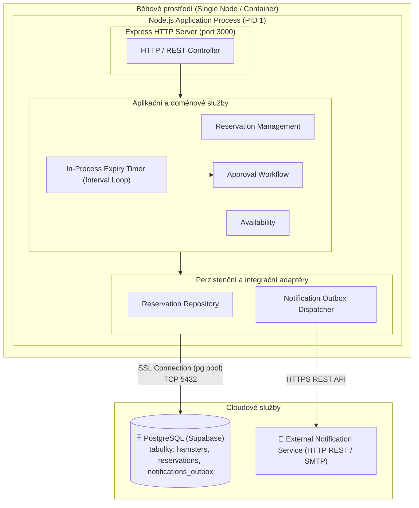
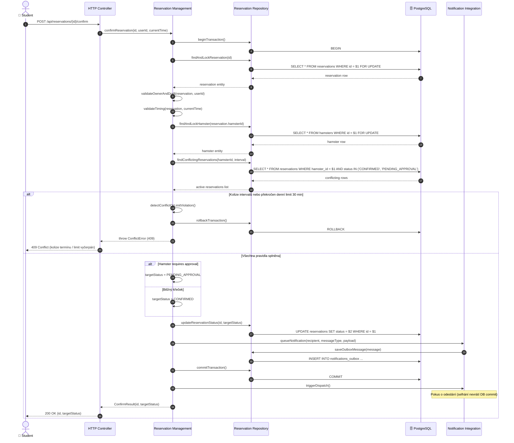
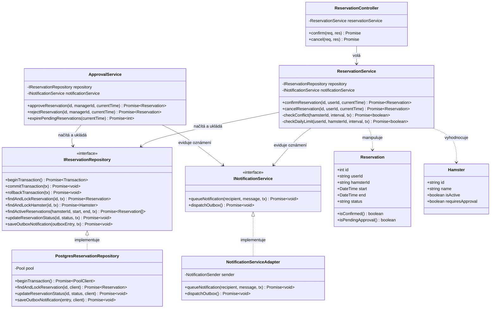

# Architektura a rozhodnutí (Architecture and Decisions)

Zde budou zaznamenávána důležitá architektonická rozhodnutí (Architecture Decision Records - ADR) a popis technického řešení.

## Technologický stack
- **Backend:** Node.js, Express, TypeScript
- **Databáze:** PostgreSQL hostovaná na platformě Supabase (cloud DB), klientská knihovna `pg` (node-postgres)
- **Připojení k DB:** Zabezpečené SSL spojení s podporou `DATABASE_URL` a Supabase Connection Pooleru
- **Vývojové nástroje:** TypeScript compiler (`tsc`), `tsx` pro vývojový režim

## Zdůvodnění volby stacku

Node.js a Express usnadňují tvorbu rezervačního API. TypeScript pomáhá zachytit typové chyby při kompilaci.

PostgreSQL se hodí pro propojená data uživatelů, křečků a rezervací a podporuje transakce (`BEGIN ... COMMIT`, `FOR UPDATE`) pro zachování konzistence dat a ochranu proti souběhu (`REQ-07`). Knihovna `pg` umožňuje přímou práci s SQL bez další vrstvy ORM.

Pro hosting databáze byl zvolen **Supabase (spravovaný PostgreSQL v cloudu)** namísto lokální instalace. Výhodou je dostupnost pro všechny členy týmu bez nutnosti lokální správy serveru, automatické zálohy a integrovaný Connection Pooler pro efektivní správu spojení. Schéma tabulek (`hamsters`, `reservations`, `notifications_outbox`) a výchozí data jsou automaticky inicializovány aplikací při startu.

---

## Část A: AS-IS realizace scénáře Confirm Reservation

Tato část dokumentu mapuje současnou implementaci systému Křečkomat
na jeden konkrétní scénář ze Specification Baseline v0.2.

Cílem je zachytit skutečný stav aplikace (AS-IS), tedy jak dnešní
implementace realizuje scénář `Confirm Reservation`, kde je uložen
stav rezervace, kde se rozhoduje o jeho změně, kde jsou vynucována
business pravidla a na jaké technické závislosti scénář spoléhá.

Analýza vychází ze skutečného kódu aplikace z C02, nikoliv z návrhu
budoucí architektury.

---

## A1. Sledovaný scénář

Pro mapování byl zvolen scénář `OP-03 Confirm Reservation`.
Tento scénář je vhodný pro architektonickou analýzu, protože propojuje
HTTP API, business logiku, databázovou transakci, kontrolu invariantů,
změnu stavu rezervace a notifikační mechanismus.

V Baseline v0.2 má operace Confirm dva možné úspěšné výsledky:

- běžný křeček: `DRAFT → CONFIRMED`,
- křeček vyžadující schválení: `DRAFT → PENDING_APPROVAL`.

| Položka | Hodnota |
|---|---|
| Scénář / operace | `OP-03 Confirm Reservation` |
| Požadavky | `REQ-05`, `REQ-06`, `REQ-07` |
| Pravidla / invarianty | `BR-01`, `BR-02`, `BR-04`, `BR-05`, `BR-06`, `BR-07` |
| Baseline | `v0.2` |

### Vazba na specifikaci

`REQ-05` určuje podmínky, za kterých může být vlastní rezervace ve
stavu `DRAFT` potvrzena. Při potvrzení se znovu kontroluje čas,
aktivita křečka, konflikt rezervací a denní limit.

`REQ-06` popisuje výsledný stav a oznámení po úspěšném potvrzení,
včetně chování při selhání Notification Service.

`REQ-07` požaduje zachování zákazu překryvu a denního limitu také
při souběžných potvrzeních.

V Baseline v0.2 je tento scénář rozšířen o možnost přechodu do
`PENDING_APPROVAL`, pokud konkrétní křeček vyžaduje schválení
Správcem křečka.

## A2. Mapování hlavního průchodu scénáře na kód

Pro hlavní úspěšný průchod je sledována rezervace běžného aktivního
křečka, který nevyžaduje schválení správcem
(`requires_approval = false`).

Výsledný stavový přechod je:

`DRAFT → CONFIRMED`

| Krok scénáře z C02 | Realizace v kódu | Doklad |
|---|---|---|
| Přijmout požadavek na potvrzení | HTTP endpoint převezme ID rezervace a `user_id` a zavolá aplikační logiku potvrzení | `src/app.ts` — `POST /api/reservations/:id/confirm` |
| Načíst rezervaci a chránit ji proti souběžné změně | Je zahájena DB transakce a rezervace je načtena pomocí `SELECT ... FOR UPDATE` | `src/service.ts` — `confirmReservation()` |
| Ověřit vlastnictví a povolený výchozí stav | Systém ověří `reservation.user_id === userId` a že aktuální stav je `DRAFT` | `src/service.ts` — `confirmReservation()` |
| Ověřit časovou podmínku potvrzení | Funkce ověří, že platí `currentTime <= start - 15 min` | `src/service.ts` — `confirmReservation()`, `src/domain.ts` — `isAtLeast15MinBefore()` |
| Ověřit aktivitu křečka | Křeček je načten pomocí `SELECT ... FOR UPDATE` a kontroluje se `is_active` | `src/service.ts` — `confirmReservation()` |
| Vyhodnotit konflikt rezervací | Vyhledají se blokující rezervace stejného křečka a pomocí pravidla překryvu se zjistí případná kolize | `src/service.ts` — `findConflictingReservation()`, `src/domain.ts` — `doIntervalsOverlap()` |
| Ověřit denní limit studenta | Systém spočítá již využité minuty stejné dvojice student–křeček a ověří maximální limit 30 minut | `src/service.ts` — `checkDailyLimitExceeded()` |
| Rozhodnout výsledný stav | Podle `hamster.requires_approval` se zvolí `CONFIRMED` nebo `PENDING_APPROVAL`; v tomto hlavním průchodu je výsledkem `CONFIRMED` | `src/service.ts` — `confirmReservation()` |
| Uložit změnu stavu a požadavek na oznámení | Stav rezervace je aktualizován a do `notifications_outbox` je vložen záznam oznámení | `src/service.ts` — `confirmReservation()` |
| Potvrdit business změnu | Databázová transakce je ukončena pomocí `COMMIT` | `src/service.ts` — `confirmReservation()` |
| Předat oznámení | Po `COMMIT` je zavolána notifikační integrace pomocí `sendNotification()`; výsledek doručení se eviduje jako`SENT` nebo `FAILED`. | `src/service.ts` — `confirmReservation()`, `src/notification.ts` — `sendNotification()` |
| Vrátit výsledek volajícímu | Service vrátí ID a výsledný stav, HTTP endpoint jej předá klientovi jako JSON | `src/service.ts` — `confirmReservation()`, `src/app.ts` — endpoint Confirm |

### Poznámka k Baseline v0.2

Současná implementace obsahuje v rámci stejné operace také druhý
úspěšný průchod pro křečka, který vyžaduje schválení:

`DRAFT → PENDING_APPROVAL`

Rozhodnutí je realizováno přímo v `confirmReservation()`:

`hamster.requires_approval ? 'PENDING_APPROVAL' : 'CONFIRMED'`

`PENDING_APPROVAL` je následně při kontrolách konfliktu a denního
limitu považován za blokující stav stejně jako `CONFIRMED`.

## A3. Alternativní větev — konflikt rezervací

Jako důležitá alternativní větev scénáře `Confirm Reservation`
je sledován případ, kdy se od vytvoření návrhu `DRAFT` objeví
jiná blokující rezervace stejného křečka ve stejném časovém intervalu.

V takovém případě nesmí původní návrh přejít do potvrzeného stavu.

| Co říká v0.2 | Kde se podmínka zjistí | Kde se rozhodne výsledek | Co dostane volající |
|---|---|---|---|
| Překryv s blokující rezervací stejného křečka → potvrzení odmítnout | `src/service.ts` — `findConflictingReservation()` načte rezervace ve stavech `CONFIRMED` a `PENDING_APPROVAL`; vlastní překryv vyhodnotí `src/domain.ts` — `doIntervalsOverlap()` | `src/service.ts` — `confirmReservation()` testuje výsledek `conflict` a při nalezené kolizi vyhodí chybu se stavem `409` | HTTP `409 Conflict` s JSON odpovědí obsahující popis kolize |

### Průchod chybovou větví

1. `POST /api/reservations/:id/confirm` přijme požadavek na potvrzení.
2. `confirmReservation()` zahájí databázovou transakci.
3. Rezervace je načtena pomocí `SELECT ... FOR UPDATE`.
4. Systém ověří vlastníka, stav `DRAFT`, čas a aktivitu křečka.
5. `findConflictingReservation()` načte blokující rezervace stejného
   křečka ve stavech `CONFIRMED` a `PENDING_APPROVAL`.
6. `doIntervalsOverlap()` zjistí, zda se některý interval překrývá
   s intervalem potvrzovaného návrhu.
7. Pokud konflikt existuje, `confirmReservation()` vyhodí chybu
   se stavem `409`.
8. `catch` v `confirmReservation()` provede `ROLLBACK`.
9. Rezervace proto zůstává ve svém původním stavu `DRAFT`.
10. HTTP endpoint v `src/app.ts` převede chybu na odpověď klientovi.

Příklad chybové odpovědi:

```json
{
  "error": "Nelze potvrdit: vznikla kolize s potvrzenou rezervací ID ...",
  "offerTimeShift": false
}
```
## A4. Hlavní části implementace

Pro scénář `Confirm Reservation` byly identifikovány následující
hlavní části současné implementace. Bloky jsou popsány na úrovni
logických modulů aplikace.

| Část implementace | Typ / obsah | Role v tomto scénáři | Doklad |
|---|---|---|---|
| `Reservation API` | HTTP/API modul — `src/app.ts` | Přijme požadavek na potvrzení, získá `reservationId`, `user_id` a aktuální čas a předá řízení business logice. Výsledek nebo chybu převádí na HTTP odpověď. | `src/app.ts` — `POST /api/reservations/:id/confirm` |
| `Reservation Service` | aplikační/business modul — `src/service.ts` | Řídí celý scénář Confirm: transakci, načtení rezervace a křečka, ověření pravidel, rozhodnutí výsledného stavu, změnu stavu a vytvoření outbox záznamu. | `src/service.ts` — `confirmReservation()` |
| `Domain Rules` | doménové funkce — `src/domain.ts` | Realizuje opakovaně použitelná business pravidla, například časovou hranici 15 minut, překryv intervalů a výpočet minut pro denní limit. | `src/domain.ts` — `isAtLeast15MinBefore()`, `doIntervalsOverlap()`, `calculateMinutesPerDay()` |
| `PostgreSQL Persistence` | PostgreSQL + SQL volání přes `pg` | Trvale ukládá rezervace, křečky a outbox oznámení. Poskytuje transakce a `FOR UPDATE`, které scénář využívá pro ochranu proti souběhu. | `src/service.ts` — SQL v `confirmReservation()`, `findConflictingReservation()`, `checkDailyLimitExceeded()`; databázové připojení v `src/db.ts` |
| `Notification Integration` | integrační modul — `src/notification.ts` | Po úspěšném potvrzení business změny se pokusí doručit oznámení. Selhání doručení nevrací rezervaci zpět a je evidováno v outboxu. | `src/notification.ts` — `sendNotification()`, `src/service.ts` — část po `COMMIT` |

### Pozorování současné struktury

Současná implementace nemá samostatnou repository vrstvu.
SQL dotazy a řízení databázové transakce jsou součástí
`src/service.ts`.

`confirmReservation()` proto v současném AS-IS řešení kombinuje
několik odpovědností:

- orchestrace scénáře;
- business rozhodování;
- práce s databází a transakcí;
- změna stavu rezervace;
- vytvoření outbox záznamu;
- spuštění notifikační integrace.

Doménová pravidla, která jsou použitelná i v jiných scénářích,
jsou částečně oddělena do `src/domain.ts`.

## A5. Stav, změna stavu a business pravidlo

### Stav

| Otázka | Odpověď | Doklad |
|---|---|---|
| Kde je stav `Reservation` trvale uložen? | V PostgreSQL databázi v tabulce `reservations`, ve sloupci `status`. | `src/service.ts` — vytvoření tabulky `reservations` v `initializeDatabase()` |
| Který kód rozhoduje/provádí přechod použitý ve scénáři? | `confirmReservation()` v `src/service.ts`. Funkce podle vlastností křečka rozhodne mezi `CONFIRMED` a `PENDING_APPROVAL` a následně nový stav uloží pomocí SQL `UPDATE`. | `src/service.ts` — `confirmReservation()` |

V hlavním sledovaném průchodu běžného křečka probíhá změna:

`DRAFT → CONFIRMED`

Pro křečka vyžadujícího schválení probíhá:

`DRAFT → PENDING_APPROVAL`

Rozhodnutí je v současné implementaci provedeno výrazem:

```ts
const targetStatus: ReservationStatus =
  hamster.requires_approval ? 'PENDING_APPROVAL' : 'CONFIRMED';
```
### Business pravidlo / invariant — BR-02

Pro sledovaný scénář bylo zvoleno pravidlo `BR-02`,
které zakazuje překrývající se blokující rezervace stejného křečka.

| Otázka | Odpověď | Doklad |
|---|---|---|
| Kde se zjistí podmínka pravidla? | `findConflictingReservation()` načte blokující rezervace stejného křečka a `doIntervalsOverlap()` vyhodnotí překryv intervalů. | `src/service.ts` — `findConflictingReservation()`; `src/domain.ts` — `doIntervalsOverlap()` |
| Kde se podle výsledku rozhodne? | `confirmReservation()` kontroluje výsledek `conflict`. Při nalezené kolizi vyhodí chybu se stavem `409`. | `src/service.ts` — `confirmReservation()` |
| Kde se provede výsledná změna stavu? | Pokud konflikt neexistuje a projdou ostatní kontroly, `confirmReservation()` uloží nový stav rezervace pomocí SQL `UPDATE`. | `src/service.ts` — `confirmReservation()` |

### Ochrana při souběhu

`Confirm Reservation` probíhá uvnitř databázové transakce.
Rezervace i příslušný křeček jsou načítáni pomocí
`SELECT ... FOR UPDATE`.

Tím současná implementace serializuje konfliktní potvrzování
rezervací stejného křečka a podporuje zachování `BR-02`
také při souběžných požadavcích.

Při chybě se provede `ROLLBACK`, při úspěchu `COMMIT`.

## A6. Relevantní závislosti

Pro scénář `Confirm Reservation` jsou v současné implementaci
relevantní především databáze PostgreSQL a notifikační integrace.

| Závislost | Kde se napojuje na náš kód | Která část zná její technické API | Doklad |
|---|---|---|---|
| PostgreSQL databáze | `confirmReservation()` načítá a mění rezervaci, načítá křečka, kontroluje konflikty a denní limit a zapisuje outbox | `src/service.ts` používá SQL a databázového klienta; `src/db.ts` poskytuje připojení přes `pool` | `src/service.ts` — `confirmReservation()`, `findConflictingReservation()`, `checkDailyLimitExceeded()`; `src/db.ts` |
| Notification Service / notifikační integrace | Po úspěšném `COMMIT` se `confirmReservation()` pokusí předat oznámení pomocí `sendNotification()` | `src/notification.ts` zapouzdřuje technický mechanismus odeslání; `src/service.ts` zná pouze funkci `sendNotification()` | `src/notification.ts` — `sendNotification()`; `src/service.ts` — `confirmReservation()` |
| Notifications outbox | Je uložen ve stejné PostgreSQL databázi a eviduje požadované oznámení a stav jeho doručení | `src/service.ts` přímo zapisuje a aktualizuje tabulku `notifications_outbox` | `src/service.ts` — `confirmReservation()`, `initializeDatabase()` |

### PostgreSQL

PostgreSQL není v tomto scénáři pouze úložištěm dat.
Současná implementace využívá také jeho transakční mechanismus:

- `BEGIN`;
- `SELECT ... FOR UPDATE`;
- `UPDATE`;
- `COMMIT`;
- při chybě `ROLLBACK`.

Databáze proto v současném AS-IS řešení podporuje nejen perzistenci
stavu, ale také ochranu business pravidel při souběžném potvrzování.

### Notification Service

Notifikační část je v současné implementaci oddělena pomocí funkce
`sendNotification()` v `src/notification.ts`.

Business změna rezervace je nejprve potvrzena v databázi a teprve
potom se systém pokusí oznámení doručit.

Pokud doručení selže:

- změna rezervace se nevrací zpět;
- outbox záznam dostane stav `FAILED`;
- volající obdrží varování.

Toto chování odpovídá požadavku, že selhání oznámení nesmí zrušit
již úspěšné potvrzení rezervace.

### Identita uživatele

Samostatný externí IdP není v současné implementaci scénáře
`Confirm Reservation` napojen.

Identita studenta je do endpointu předávána prostřednictvím
`user_id` v HTTP požadavku a `confirmReservation()` pouze porovnává
tuto hodnotu s `reservation.user_id`.

Proto IdP není součástí současného AS-IS diagramu. Jeho konkrétní
integrace zůstává mimo rozsah současné implementace.


## A7. AS-IS strukturální diagram

Následující diagram zachycuje současnou realizaci scénáře
`Confirm Reservation`. Nejde o cílovou architekturu, ale o skutečnou
strukturu implementace vzniklé v C02.

```text
                         HTTP confirm request
                                |
                                v
+--------------------------- Application code ----------------------------+
|                                                                         |
|  +-----------------------+                                              |
|  | Reservation API       |                                              |
|  | src/app.ts            |                                              |
|  | přijme confirm request|                                              |
|  +-----------+-----------+                                              |
|              | confirmReservation(id, userId, now)                      |
|              v                                                          |
|  +-----------------------+                                              |
|  | Reservation Service   |----------------------+                       |
|  | src/service.ts        |                      |                       |
|  | řídí Confirm          |                      |                       |
|  +-----+------------+----+                      |                       |
|        |            |                           |                       |
|        | použije    | sendNotification()        | SQL / transaction     |
|        v            v                           |                       |
|  +-------------+  +-------------------------+   |                       |
|  | Domain Rules|  | Notification Integration|  |                       |
|  | domain.ts   |  | notification.ts         |  |                       |
|  | čas, overlap|  | pokus o doručení        |  |                       |
|  | denní limit |  +-------------------------+  |                       |
|  +-------------+                               |                       |
|                                                |                       |
+------------------------------------------------|-----------------------+
                                                 |
                                                 | SELECT / UPDATE /
                                                 | INSERT / FOR UPDATE /
                                                 | COMMIT / ROLLBACK
                                                 v
                                      +-----------------------+
                                      | PostgreSQL database   |
                                      | reservations          |
                                      | hamsters              |
                                      | notifications_outbox  |
                                      +-----------------------+
```
                                    


---


## A8. Otázka pro další architektonický návrh

| Položka | Obsah |
|---|---|
| **Otázka** | Jak oddělit orchestraci a business logiku potvrzení rezervace od přímého psaní SQL dotazů a nízkoúrovňové správy databázových transakcí (např. zavedením Repository vzoru a Unit of Work), aby byl kód čistě testovatelný bez nutnosti živé PostgreSQL databáze a snížila se vysoká provázanost v `Reservation Service`? |
| **Doklad** | `src/service.ts` — funkce `confirmReservation()`, `findConflictingReservation()` a `checkDailyLimitExceeded()` přímo v sobě sestavují a provádějí raw SQL dotazy (`client.query('SELECT ... FOR UPDATE')`, `client.query('UPDATE ...')`, `BEGIN`, `COMMIT`, `ROLLBACK`), spravují klienta z poolu a současně vyhodnocují doménová pravidla a připravují outbox. Jak bylo uvedeno v sekci A4, v současné implementaci zcela chybí samostatná perzistenční vrstva (Repository). |
| **Proč je důležitá** | V současném AS-IS stavu lze sice čisté doménové funkce v `domain.ts` (např. výpočet intervalů a překryvů) testovat bez databáze, avšak aplikační orchestrace a perzistence jsou pevně svázány s konkrétním ovladačem PostgreSQL a raw SQL dotazy v `service.ts`. To brání psaní rychlých izolovaných testů pro kompletní službový scénář bez nutnosti živé PostgreSQL, porušuje princip jedné odpovědnosti (SRP) a činí jakoukoliv budoucí úpravu schématu či transakcí náročnou na údržbu v navazujících krocích C03 a CP1. |

---

# Část B: Architektonické drivery

Zpřesnění 4 klíčových driverů podložených požadavky, pravidly a nálezy z Části A:

| Podklad / zdroj | Proč ovlivňuje architekturu | Otázka, kterou musí architektura vyřešit |
|---|---|---|
| `BR-02`, `REQ-04`, `REQ-07`, Part A (A2, A3) | Dva souběžné požadavky mohou v tentýž okamžik vidět termín jako volný; bez přísné transakční izolace hrozí dvojí rezervace a porušení invariantu exkluzivity. | Kde a jak se musí provést autoritativní confirmation decision, aby `BR-02` zůstalo pravdivé i při souběhu? |
| `REQ-10`, `REQ-13`, `BR-03`, Part B baseline v0.2 | Rozhodnutí správce přichází asynchronně s časovou prodlevou; stav `PENDING_APPROVAL` musí přežít konec requestu a při nečinnosti musí v čase `start - 1h` spolehlivě proběhnout expirace. | Kdo vlastní stav čekajícího schválení a kdo provede pozdější přechod do `CONFIRMED`, `REJECTED` či `EXPIRED`? |
| `REQ-06`, `BR-06`, Part A (A2) | `Notification Service` je externí nespolehlivá služba; selhání doručení nesmí zvrátit již provedenou a commitnutou business změnu v databázi. | Má selhání notifikace ovlivnit úspěch potvrzení rezervace a kde má být izolována integrace a správa outboxu? |
| Part A nález A8, `src/service.ts`, `src/domain.ts` | V AS-IS implementaci je orchestrace srostlá s raw SQL dotazy a přímým řízením transakcí, což ztěžuje unit testování business scénářů bez PostgreSQL databáze. | Jak strukturálně oddělit doménovou logiku potvrzení od perzistence a databázových transakcí? |

---

# Část C1: Doménový třídní model

Doménový model zachycuje klíčové doménové pojmy pro scénář potvrzení rezervace a schvalovací proces bez závislostí na frameworku, kontrolerech či perzistenci:



**Klíčové doménové invarianty:**
- **BR-01:** Polouzavřený interval `[start, end)`.
- **BR-02:** Jeden křeček nesmí mít dva překrývající se intervaly se stavy `CONFIRMED` nebo `PENDING_APPROVAL`.
- **BR-03:** Potvrzení a storno nejpozději 15 minut před začátkem (`currentTime <= start - 15 min`). Rozhodnutí správce pouze při `currentTime < start - 1h`.
- **BR-04:** Dvojice student–křeček má maximálně 30 minut rezervací v jednom kalendářním dni (počítají se `CONFIRMED` a `PENDING_APPROVAL`).
- **BR-07:** Rezervovat a schválit lze pouze aktivního křečka (`isActive = true`).

---

# Část C2: Odpovědnosti systému

| Zdroj | Odpovědnost | Co musí rozhodovat / vlastnit | Potřebuje 1 jasného vlastníka? | Důvod | S čím musí být seskupena | Od čeho má být oddělena |
|---|---|---|:---:|---|---|---|
| Confirm + statechart | Rozhodnout o platnosti potvrzení a cílovém stavu | Přechod `DRAFT → CONFIRMED` nebo `DRAFT → PENDING_APPROVAL` | Ano | Různé části nesmí rozhodnout odlišně; rozhodnutí musí být autoritativní. | S kontrolou časové lhůty (`BR-03`) a příznakem schvalování křečka. | Od HTTP routování, formátování JSON a přímého odesílání e-mailů. |
| `BR-02`, `REQ-07` | Vyhodnotit konflikt a zachovat invariant | Detekce překryvu intervalů v transakčním zámku | Ano | Souběh dvou potvrzení nesmí porušit exkluzivitu alokace křečka. | S atomickou perzistencí a zamykáním řádků v transakci. | Od uživatelského rozhraní a notifikačního mechanismu. |
| `BR-04` | Kontrola a výpočet denního limitu | Agregace minut a vyhodnocení nepřekročení 30 min denně | Ano | Invariant denního limitu studenta nesmí být obcházen souběhem. | S doménovou logikou časových intervalů v kalendářním dni. | Od nízkoúrovňového SQL driveru. |
| Approval change (`REQ-10`–`REQ-12`) | Správa čekajícího schválení | Stav `PENDING_APPROVAL`, provedení Approve/Reject správcem | Ano | Stav žádosti přežívá request studenta a vyžaduje autorizaci správce. | S doménovými pravidly role správce a kontrolou lhůty `start - 1h`. | Od běžného studentského rezervačního toku. |
| Expiration (`REQ-13`, `REQ-14`) | Hlídání a provádění expirace | Přechod `PENDING_APPROVAL → EXPIRED` při `currentTime >= start - 1h` | Ano | Uvolňuje zablokovaného křečka i studentův limit při nečinnosti správce. | Se schvalovacím životním cyklem. | Od synchronního zpracování příchozích HTTP requestů. |
| Persistence (`A8`) | Atomické uložení a čtení dat | Transakční hranice (`BEGIN`, `COMMIT`, `ROLLBACK`), načítání entit | Ano | Zajišťuje trvalost a konzistenci datového modelu. | S databázovým adaptérem (Repository). | Od čisté business logiky doménových pravidel. |
| Notification (`BR-06`, `REQ-06`) | Příprava a spolehlivé doručení oznámení | Zápis outbox zprávy v transakci a následné předání odesílači | Podle návrhu | Externí selhání nesmí narušit uložený business stav rezervace. | S transakčním outbox úložištěm. | Od hlavní business logiky schválení či potvrzení. |

---

# Část D: Hlavní rozhodovací otázka

```text
Rozhodovací otázka:
Kde a jak má být vlastněn delayed approval workflow a časovač expirací nerozhodnutých žádostí?
```

---

# Část E1: Dvě materiálně odlišné alternativy

```text
Alternativa A — In-process modul uvnitř stejného deployable

+-------------------------------------------------------------------+
| [Reservation Application] (jediný Node.js proces)                  |
|   ├─ [Reservation Management] (přijetí požadavku, přechody DRAFT) |
|   ├─ [Approval Workflow] (správa PENDING_APPROVAL, Approve/Reject)|
|   └─ [In-Process Expiry Timer] (periodická kontrola start - 1h)   |
+-------------------------------------------------------------------+
                                  |
                                  v
                            [PostgreSQL]
```

```text
Alternativa B — Samostatný runtime worker proces

+-------------------------------------+
| [Reservation Application]           |
| (HTTP REST API proces)              |
|   └─ [Reservation Management]       |
+-------------------------------------+
                 |
                 v
           [PostgreSQL] <-------------+
                                      | čtení/zápis expirací
+-------------------------------------+
| [Approval & Expiry Worker]          |
| (samostatný background proces / cron)|
|   └─ [Worker / Scheduler Engine]    |
+-------------------------------------+
```

---

# Část E2: Porovnání alternativ vůči driverům

| Driver / kritérium | Alternativa A (In-process modul) | Alternativa B (Samostatný runtime worker) |
|---|---|---|
| **Konzistence a invarianty (`BR-02`, `BR-03`)** | Přímé volání doménové služby v rámci stejné transakce/DB poolu; minimální prodleva mezi časovou hranicí a expirací; okamžitá konzistence. | Stejná databázová transakce, ale worker provádí polling v periodických intervalech; mírné zpoždění reakce na hranici `start - 1h` v závislosti na intervalu workeru. |
| **Chování při selhání (Failure behaviour)** | Pokud spadne aplikační proces, zastaví se i časovač; po restartu však první kontrola okamžitě zpracuje všechny expirované žádosti (idempotentní restart recovery). | Pád webového serveru neovlivní worker expirací; pád workeru neovlivní HTTP API. Vyžaduje však samostatný monitoring dvou běžících služeb. |
| **Změna / ownership** | Jednotná codebase a sdílené doménové entity; změna pravidel expirace či schválení je na jednom místě; nižší režie vývoje. | Přísná procesní izolace; nutnost sdílet doménový kód/knihovnu mezi dvěma procesy nebo komunikovat přes interní API / DB kontrakt. |
| **Provozní složitost** | Nízká; jeden proces, jedno nasazení, nulová nutnost externího orchestrátoru procesů; ideální pro prototyp a cvičení. | Vyšší; vyžaduje správu více procesů (Docker compose, PM2, Kubernetes cronjob), složitější CI/CD pipeline a lokální debugování. |

---

# Část E3: Scénářový walkthrough obou alternativ

Sledovaný scénář: `Confirm Reservation` pro křečka vyžadujícího schválení (*Archimedes*), následovaný nečinností správce a automatickou expirací žádosti v čase `start - 1h`:

| Krok / událost | Alternativa A (In-process modul) | Alternativa B (Samostatný runtime worker) |
|---|---|---|
| 1. Student odešle `Confirm` | Express endpoint zavolá `Reservation Management`. | Express endpoint zavolá `Reservation Management`. |
| 2. Zjištěna potřeba schválení | Služba v transakci ověří pravidla a nastaví `status = PENDING_APPROVAL`, zapíše notifikaci pro správce do outboxu. | Služba v transakci ověří pravidla a nastaví `status = PENDING_APPROVAL`, zapíše notifikaci pro správce do outboxu. |
| 3. Ukončení iniciačního requestu | Transakce commitnuta; student obdrží HTTP `200 OK` se stavem `PENDING_APPROVAL`. Spojení se ukončí. | Transakce commitnuta; student obdrží HTTP `200 OK` se stavem `PENDING_APPROVAL`. Spojení se ukončí. |
| 4. Správce v čase nereaguje | Rezervace trvale perzistována v PostgreSQL v mezistavu; dočasně blokuje křečka i denní limit. | Rezervace trvale perzistována v PostgreSQL v mezistavu; dočasně blokuje křečka i denní limit. |
| 5. Čas dosáhne hranice `start - 1h` | Interní in-process časovač detekuje překročení hranice při nejbližším ticku, spustí doménovou expiraci. | Samostatný worker proces při svém běhu/polling cyklu detekuje překročení hranice v DB a spustí expiraci. |
| 6. Zpracování expirace a uvolnění | V transakci nastaven stav `EXPIRED`, uvolněn termín i limit, vygenerována notifikace oběma stranám do outboxu. | V transakci nastaven stav `EXPIRED`, uvolněn termín i limit, vygenerována notifikace oběma stranám do outboxu. |
| 7. Souběžný pokus správce o schválení | Transakční zámek `SELECT FOR UPDATE` zajistí, že buď zvítězí expirace a schválení je odmítnuto, nebo naopak. | Transakční zámek v DB zajistí stejný atomický výsledek i při souběhu oddělených procesů. |

---

# Část F: Architektonické rozhodnutí (ADR)

## ADR-01 — Umístění a vlastnictví delayed approval workflow a časovače expirací

- **Kontext:**  
  V Baseline v0.2 některé rezervace přecházejí do stavu `PENDING_APPROVAL`, kde čekají na manuální rozhodnutí správce křečka. Pokud správce nerozhodne do času `start - 1h`, systém musí žádost automaticky převést do stavu `EXPIRED` a uvolnit alokaci i limit. Současně je vyžadováno spolehlivé chování při souběhu a minimální provozní režie.

- **Drivery:**  
  - Zachování invariantů `BR-02` a `BR-03` při souběhu a v čase.
  - Asynchronní správa stavu přesahující životnost HTTP požadavku.
  - Spolehlivost a obnova po výpadku (restart recovery).
  - Přiměřenost provozní složitosti pro demonstrační a akademické nasazení.

- **Alternativa A:**  
  In-process modul uvnitř stejného Node.js deployable s neblokujícím časovačem a ručně vyvolatelným obslužným endpointem.

- **Alternativa B:**  
  Samostatný runtime proces / worker oddělený od webové aplikace.

- **Rozhodnutí:**  
  Přijata **Alternativa A** — delayed approval workflow i časovač expirací jsou organizovány jako samostatný doménový modul `Approval Workflow` uvnitř stejného monolitického Node.js procesu, napojený na společnou PostgreSQL databázi. Modul je navržen s jasným rozhraním, které umožní budoucí fyzické vyčlenění do samostatného workeru bez změny doménové logiky.

- **Důvod:**  
  Alternativa A splňuje všechny požadavky na transakční bezpečnost a zachování invariantů při dramaticky nižší provozní složitosti. Všechny operace probíhají v PostgreSQL transakcích s `FOR UPDATE`, takže atomicita přechodů je zaručena. Při restartu aplikace je zajištěna okamžitá obnova, kdy úvodní běh zpracuje všechny expirované žádosti.

- **Přijaté negativní důsledky:**  
  Při úplném pádu jediného Node.js procesu se hlídání expirací dočasně pozastaví, dokud proces nenastartuje znovu. Časovač sdílí výpočetní zdroje s HTTP serverem (v daném měřítku systému zanedbatelné).

- **Rozhodnutí znovu otevřeme, když:**  
  Zátěž systému vzroste natolik, že kontrola expirací začne ovlivňovat latenci HTTP požadavků, nebo pokud bude vyžadováno horizontální škálování webové vrstvy na více instancí (kde by in-process timer vyžadoval distribuovaný zámek).

---

# Část G1: Kontextový diagram systému



---

# Část G2: TO-BE statická architektura

Seskupení odpovědností do logických architektonických prvků s explicitním vlastnictvím stavu a invariantů:



---

# Část G3: Ownership přechodů ve statechartu z C02

| Přechod | Owner rozhodnutí (z G2) | Kdo může transition pouze vyžádat | Invariant / podmínka přechodu |
|---|---|---|---|
| `[neexistuje] → DRAFT` | **Reservation Management** | Student (OP-01) | Platný interval, křeček aktivní, předstih >= 15 min, předběžná kontrola limitu |
| `DRAFT → CONFIRMED` | **Reservation Management** | Student (OP-03) | `currentTime <= start - 15 min`, křeček nevyžaduje schválení, žádný překryv (`BR-02`), limit <= 30 min |
| `DRAFT → PENDING_APPROVAL` | **Reservation Management** | Student (OP-03) | `currentTime <= start - 15 min`, křeček vyžaduje schválení, žádný překryv (`BR-02`), limit <= 30 min |
| `PENDING_APPROVAL → CONFIRMED` | **Approval Workflow** | Správce křečka (OP-05 Approve) | `currentTime < start - 1h`, křeček aktivní, role správce |
| `PENDING_APPROVAL → REJECTED` | **Approval Workflow** | Správce křečka (OP-05 Reject) | `currentTime < start - 1h`, role správce; uvolňuje blokaci a denní limit |
| `PENDING_APPROVAL → EXPIRED` | **Approval Workflow** | Časovač expirací / Timer (OP-06) | `currentTime >= start - 1h`; uvolňuje blokaci a denní limit |
| `DRAFT → CANCELLED` | **Reservation Management** | Student (OP-04) | Vlastník rezervace, `currentTime <= start - 15 min` |
| `CONFIRMED → CANCELLED` | **Reservation Management** | Student (OP-04) | Vlastník rezervace, `currentTime <= start - 15 min`; uvolňuje křečka i limit |
| `PENDING_APPROVAL → CANCELLED` | **Reservation Management** | Student (OP-04) | Vlastník rezervace, `currentTime <= start - 15 min`; uvolňuje křečka i limit |
| `CANCELLED → CANCELLED` | **Reservation Management** | Student (OP-04) | Idempotentní opakování bez změny dat a bez notifikace |

---

# Část G4: Runtime / deployment mapping

Mapování logických komponent z G2 do konkrétních běhových procesů:



---

# Část H1: Návrhový sekvenční diagram (Confirm Reservation)

Realizace scénáře Confirm Reservation v přijaté TO-BE architektuře včetně větvení pro kolizi (`alt` větev) a pro křečka vyžadujícího schválení:



---

# Část H2: Zaměřený návrhový třídní diagram

Třídní diagram znázorňuje strukturální vlastníky všech operací a zpráv ze sekvenčního diagramu H1 a definuje rozhraní pro perzistenci i notifikace:



---

# Část I: Cross-view kontrola

| Kontrola | Ověřovaná otázka | Výsledek a zhodnocení v návrhu |
|---|---|---|
| **C02 ↔ G2** | Umí architektura realizovat požadované chování a pravidla? | **Ano.** Komponenty `Reservation Management` a `Approval Workflow` plně pokrývají `OP-01` až `OP-06` a striktně vynucují pravidla `BR-01` až `BR-07`. |
| **C2 ↔ G2** | Má každá významná odpovědnost jednoho ownera? | **Ano.** Životní cyklus rezervace vlastní `Reservation Management`, schvalovací proces a expiraci `Approval Workflow`, transakční perzistenci `Reservation Persistence` a notifikace `Notification Integration`. Žádná odpovědnost není duplicitní. |
| **G2 ↔ H1** | Používá sekvence pouze existující / povolené závislosti? | **Ano.** Sekvenční diagram H1 volá výhradně směry definované v G2: Controller → Reservation Management → Repository & Notification Integration. |
| **H1 ↔ H2** | Má každá významná zpráva / operace strukturálního vlastníka? | **Ano.** Všechny metody v sekvenci (`confirmReservation`, `findAndLockReservation`, `saveOutboxNotification`) mají své explicitní signatury a vlastníky v třídním diagramu H2. |
| **statechart ↔ G3/H1** | Rozhoduje transition správný owner? | **Ano.** Přechody do `CONFIRMED` a `PENDING_APPROVAL` rozhoduje `Reservation Management`, přechody ze schválení a expirace rozhoduje `Approval Workflow`. Odpovídá tabulce G3 i větvení v H1. |
| **G2 ↔ G4** | Je každý logický prvek realisticky namapovaný do runtime? | **Ano.** Všechny logické prvky jsou realisticky umístěny uvnitř jediného Node.js procesu běžícího nad společným pool PostgreSQL (Supabase). |
| **ADR ↔ G2/G4** | Je přijaté rozhodnutí skutečně vidět v architektuře? | **Ano.** Rozhodnutí ADR-01 (In-process modul pro approval a expiraci v monolitickém procesu) je přímo znázorněno v G2 jako propojené moduly a v G4 jako runtime moduly uvnitř procesu PID 1. |

---

# Část J: AS-IS → TO-BE delta matice

| Oblast | AS-IS implementace | TO-BE architektura | Akce |
|---|---|---|:---:|
| **Změna stavu rezervace** | Spojeno v `service.ts` v jedné proceduře s přímým SQL. | Oddělená doménová služba `ReservationService` / `ApprovalService` s autoritativním řízením přechodů. | `KEEP` |
| **Perzistenční vrstva (Repository)** | Neexistuje; SQL dotazy jsou psány přímo v `service.ts`. | Explicitní rozhraní repozitáře `repository.ts` vyčleňující SQL dotazy od orchestrace. | `CHANGE` |
| **Hlídání expirací (Scheduler)** | Pouze manuálně volaný endpoint `POST /api/reservations/expire`. | In-process neblokující timer spouštějící periodickou kontrolu expirací. | `CHANGE` |
| **Transakční izolace souběhu** | `SELECT ... FOR UPDATE` v atomické transakci zajišťující `BR-02`. | Zachování `SELECT ... FOR UPDATE` pod rozhraním repozitáře. | `KEEP` |
| **Čisté doménové funkce (`domain.ts`)** | Nezávislé čisté funkce pro intervaly a překryvy. | Ponechány beze změny jako základ doménového jádra. | `KEEP` |
| **Architektonické pravidlo** | Žádná automatická kontrola zákazů závislostí. | Vytvoření opakovatelného architektonického testu chránícího vrstvy (např. zákaz importu `pg` mimo repository/db). | `CHANGE` |
